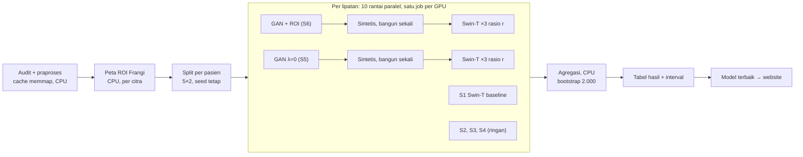

# PRD – Klasifikasi Lesi Laring CE-NBI dengan Augmentasi GAN Berpandu ROI

8 November 2026 · Wahyu Andika dan Ahmad Nur Mu'minin · Versi Docs: https://claude.ai/artifact/DdFbmSiDxc7immfaC3mWEW

Dokumen ini menetapkan apa yang harus dibangun agar proyek menjawab satu pertanyaan: apakah augmentasi GAN kondisional berpanduan ROI pembuluh memperbaiki klasifikasi lesi laring jinak dan ganas pada evaluasi per pasien, dibanding SMOTE dan replikasi Wang dkk.

## 1. Ringkasan Produk

Produk terdiri dari dua bagian. Pertama, **pipeline eksperimen** yang menjalankan skenario S1 sampai S7 pada 210 pasien CE-NBI dengan validasi silang per pasien (5 lipatan × 2 ulangan) dan menghasilkan AUROC, F1, dan recall tingkat pasien beserta interval kepercayaan. Kedua, **website prototipe** yang menjalankan klasifikator terbaik untuk satu pasien dan menampilkan probabilitas ganas, perbandingan dua model, dan area yang memengaruhi prediksi.

| Aspek | Isi |
| --- | --- |
| Pengguna utama | Dua peneliti: Wahyu Andika dan Ahmad Nur Mu'minin |
| Peninjau | Dosen pengampu, Dr. Ir. Agus Eko Minarno |
| Keluaran utama | Tabel hasil S1–S7 dengan interval kepercayaan 95%, Tabel 3.4 (perbandingan dengan penelitian terdahulu), artikel, laporan, prototipe website |
| Kebutuhan komputasi | Sekitar 20 pelatihan GAN dan sekitar 80 pelatihan Swin Transformer; dataset hanya 1,4 GB, sehingga paralel dilakukan per pekerjaan (lipatan/skenario), bukan per data |
| Status | Draf untuk disetujui peneliti; perangkat keras belum ditetapkan |

## 2. Latar Belakang dan Masalah

Manfaat augmentasi GAN pada CE-NBI laring belum teruji dengan evaluasi per pasien yang kuat. Data CE-NBI publik (Zenodo 6674034) berisi 11.144 citra dari 210 pasien satu pusat, dengan citra jinak 7.657 dan ganas 3.487 (sekitar 2,2 : 1). Satu pasien menghasilkan banyak citra mirip, sehingga pembagian per citra menggelembungkan kinerja.

Acuan utama, Wang dkk. (2026), mengaugmentasi di ruang fitur radiomik. Median F1 mereka turun dari 0,970 pada validasi silang ke 0,851 pada 30 pasien uji (7 ganas), dan manfaat GAN hanya muncul pada SVM linear dan LDA. Kode repositori mereka menunjukkan bahwa "GAN" itu adalah CTGAN tabular, dengan sampel sintetis tetap 50% dari data latih.

Celah yang diisi penelitian ini: (a) sintesis pada citra, bukan fitur; (b) panduan wilayah pembuluh lewat ROI; (c) rasio sintetis divariasikan (25%, 50%, 100%); (d) evaluasi per pasien berulang dengan interval kepercayaan pada 210 pasien; (e) uji pergeseran resolusi akuisisi.

## 3. Sasaran dan Metrik Keberhasilan

Proyek berhasil bila lima sasaran di bawah terjawab dengan bukti yang dapat diulang, apa pun arah hasilnya. Hasil negatif (GAN tidak membantu) tetap hasil yang sah selama evaluasinya benar.

| ID | Sasaran | Ukuran keberhasilan |
| --- | --- | --- |
| G1 | Mengukur kinerja tiap skenario pada 210 pasien | AUROC, F1, recall tingkat pasien dengan interval kepercayaan 95% (bootstrap persentil bertingkat, 2.000 ulangan) |
| G2 | Menentukan rasio sintetis yang bermanfaat dan merugikan | Hasil r = 25%, 50%, 100% dilaporkan semua; rasio dipilih dari validasi di dalam lipatan latih, bukan lipatan uji |
| G3 | Menguji kontribusi panduan ROI | Ablation λ_roi = 0 lawan λ_roi > 0 pada FID, metrik struktur pembuluh, dan kinerja hilir |
| G4 | Menguji ketahanan terhadap pergeseran resolusi (S7) | Selisih kinerja latih 1280×1008 → uji gabungan 4 resolusi lain, dengan interval kepercayaan |
| G5 | Prototipe website | Pengguna mengunggah citra satu pasien dan memperoleh probabilitas dua model dalam waktu yang wajar (batas dibenchmark di Fase 0) |

Sebuah perbaikan disebut bermakna bila interval kepercayaan 95% selisih berpasangan (pasien yang sama) tidak mencakup nol. Perbandingan utama ditetapkan sebelum eksperimen: skenario usulan (S6) lawan S1 dan S2 pada AUROC dan F1. Perbandingan lain bersifat eksploratif dan dilabeli demikian.

Sasaran operasional: seluruh angka di laporan dapat direproduksi dari satu perintah dan satu berkas konfigurasi, dan pemeriksaan otomatis kebocoran data lolos pada setiap lipatan.

## 4. Ruang Lingkup

Lingkup mengikuti Batasan Masalah proposal (subbab 1.4); PRD ini tidak menambah klaim di luarnya.

**Dalam lingkup**

- Klasifikasi biner jinak/ganas pada dataset CE-NBI Zenodo (210 pasien, satu pusat).
- Satu varian GAN kondisional (StyleGAN2-ADA, kondisi kelas) dengan diskriminator tambahan D_roi berpanduan ROI pembuluh.
- Pembanding: SMOTE pada embedding Swin beku (S2) dan replikasi ringkas pipeline Wang dkk. dengan SVM linear dan LDA (S3, S4).
- Citra sintetis hanya pada data latih; generator dan klasifikator memakai pasien partisi latih yang sama.
- Uji pergeseran resolusi (S7) dengan skema latih resolusi mayoritas, uji resolusi lain.
- Website prototipe yang hanya menjalankan klasifikator, dengan peta panas Grad-CAM atau attention rollout berlabel "area yang memengaruhi prediksi".

**Di luar lingkup**

- Diffusion model (hanya dibahas di tinjauan pustaka), VAE, KNN, dan Random Forest pada replikasi Wang dkk.
- Teks + citra (multimodal), penilaian realisme citra sintetis oleh dokter, validasi multi-pusat.
- Evaluasi kuantitatif peta panas; peta panas bukan lokalisasi lesi.
- Penggunaan klinis: website adalah prototipe riset, bukan alat diagnosis.
- Menjalankan GAN di website.

## 5. Data dan Praproses

Dataset lokal sudah diverifikasi dari struktur folder dan cocok dengan Tabel 3.2 proposal; satu hal harus diaudit sebelum S7 dipakai.

| Kelas | Pasien | Citra | Rata-rata citra/pasien |
| --- | --- | --- | --- |
| Jinak | 150 | 7.657 | 51,05 |
| Ganas | 60 | 3.487 | 58,12 |
| Total | 210 | 11.144 | 53,07 |

Folder dataset: `Benign/<histopatologi>/PatientXXX/` dan `Malignant/<histopatologi>/PatientXXX/`, ditambah `Patients_List_Updated_Final.xlsx`. Total sekitar 1,4 GB.

**Temuan audit (harus ditindaklanjuti di Fase 0).** Repo Kiani dkk. menghitung 11.157 citra, 151 pasien jinak dan 59 ganas (7.715 dan 3.442 citra). Selisih 1 pasien dan 13 citra dengan data lokal berarti berkas lipatan dan pembagian resolusi mereka tidak boleh dipakai mentah-mentah. Pipeline membuat ulang semua split dari data lokal.

Sebaran resolusi di bawah berasal dari manifest repo Kiani dkk. (setiap pasien hanya punya satu resolusi) dan harus dihitung ulang dari gambar lokal:

| Resolusi | Pasien jinak | Pasien ganas | Citra |
| --- | --- | --- | --- |
| 1280×1008 | 101 | 36 | 6.714 |
| 868×540 | 19 | 9 | 1.476 |
| 1736×1080 | 10 | 9 | 1.266 |
| 720×544 | 14 | 3 | 1.153 |
| 1842×1080 | 7 | 2 | 548 |

**Praproses (lima langkah, urutan tetap).** (1) Saring frame buram, silau, gelap bila metadata belum menandainya. (2) Potong area pandang dengan mask lingkaran. (3) Ubah ukuran: 256×256 untuk GAN, 224×224 untuk klasifikator. (4) Normalisasi dengan rata-rata dan simpangan baku data latih tiap lipatan. (5) Peta ROI pembuluh: filter Frangi pada kanal hijau di dalam area pandang, dibinerkan dengan ambang tetap.

**Cache.** Hasil praproses disimpan sekali sebagai array uint8 yang dipetakan ke memori (memmap): sekitar 2,2 GB untuk 11.144 citra RGB 256×256 dan sekitar 0,7 GB untuk peta ROI. Semua worker membaca berkas yang sama, sehingga pembacaan JPEG tidak diulang pada tiap job.

## 6. Skenario Eksperimen S1–S7

Semua skenario memakai pembagian per pasien, validasi silang 5 lipatan × 2 ulangan (10 lipatan), dan agregasi probabilitas per pasien dengan rata-rata dan ambang 0,5. Sekitar 20 pelatihan GAN dan sekitar 80 pelatihan Swin Transformer penuh berasal dari tabel ini; S2, S3, dan S4 ringan.

| ID | Deskripsi | Fungsi | Sumber daya | Job (perkiraan) |
| --- | --- | --- | --- | --- |
| S1 | Swin-T pralatih ImageNet tanpa augmentasi generatif, weighted sampling | Baseline | GPU | 10 |
| S2 | Swin-T beku, SMOTE pada embedding, kepala linear | Pembanding augmentasi klasik | GPU sekali untuk embedding, lalu CPU | 10 |
| S3 | 104 fitur PyRadiomics, MinMax, LASSO, SMOTE, SVM linear dan LDA | Replikasi Wang dkk. | CPU | 10 |
| S4 | S3 dengan GAN pada ruang fitur (50% data latih) | Replikasi Wang dkk. | CPU (GPU opsional) | 10 |
| S5 | cGAN tanpa ROI (λ_roi = 0), r = 25%, 50%, 100% | Ablation panduan ROI | GPU | 10 GAN + 30 Swin |
| S6 | cGAN berpanduan ROI vaskular, r = 25%, 50%, 100% | Metode usulan | GPU | 10 GAN + 30 Swin |
| S7 | Latih pada 1280×1008, uji gabungan 4 resolusi lain, untuk S1 dan konfigurasi terbaik S5 dan S6 | Ketahanan terhadap akuisisi | GPU | kira-kira 10 |

Satu GAN per lipatan cukup untuk ketiga rasio: generator membangkitkan 100% sekali, lalu subset 25% dan 50% diambil darinya, sehingga rasio tidak menambah pelatihan GAN.

**Keputusan S7.** S7 dijalankan dengan satu kelompok uji gabungan, bukan per resolusi. Hanya resolusi 1280×1008 yang memenuhi syarat proposal (minimal 10 pasien ganas dan 10 jinak); keempat resolusi lain masing-masing hanya punya 2–9 pasien ganas. Gabungan keempatnya, 50 pasien jinak dan 23 ganas (73 pasien), memenuhi syarat dan sama dengan skema Kiani dkk. Generator dan klasifikator S7 hanya dilatih dari 137 pasien resolusi 1280×1008. Syarat ini harus diperiksa ulang dari gambar lokal (lihat bagian 5) sebelum S7 dijalankan.

Catatan interpretasi: proporsi ganas berbeda antar resolusi (49% pada 1736×1080, 22–33% pada lainnya), sehingga S7 mengukur pergeseran akuisisi yang bercampur dengan perbedaan populasi, bukan efek resolusi murni.

## 7. Persyaratan Fungsional Pipeline

Tiap persyaratan punya kriteria penerimaan yang bisa diperiksa dengan perintah, bukan dengan penilaian.

| ID | Persyaratan | Kriteria penerimaan |
| --- | --- | --- |
| FR-01 | Audit data dari gambar lokal: citra, pasien, kelas, dan resolusi per pasien | Menghasilkan `audit.csv`; angka sama dengan Tabel 3.2 atau selisihnya dilaporkan; syarat S7 dihitung otomatis |
| FR-02 | Praproses lima langkah dan cache memmap | Dijalankan sekali; cache diberi hash konfigurasi; job membaca cache, tidak membaca JPEG |
| FR-03 | Peta ROI pembuluh dengan filter Frangi pada kanal hijau | Parameter dikunci setelah pemeriksaan visual 50 citra; contoh disimpan untuk Gambar 3.2 |
| FR-04 | Split per pasien: 5 lipatan × 2 ulangan, 15% pasien latih sebagai validasi | Berkas split disimpan; uji otomatis menyatakan tidak ada pasien yang muncul di latih dan uji sekaligus |
| FR-05 | Klasifikator Swin-T tiny pralatih ImageNet, kepala linear dua kelas | AdamW 1e-4, weight decay 0,05, batch 32, maksimal 30 epoch, henti dini sabar 5 epoch, weighted sampling, augmentasi klasik; tiap perubahan dicatat |
| FR-06 | cGAN StyleGAN2-ADA 256×256 dengan D_roi dan L_G = L_adv(G,D) + λ_roi·L_adv(G,D_roi) | Dilatih hanya pada pasien partisi latih; FID dipantau; 100 citra sintetis per kelas diperiksa visual; keragaman diukur dengan LPIPS |
| FR-07 | Pembangkitan sintetis | 100% jumlah citra ganas asli dibangkitkan sekali; subset 25% dan 50% diambil darinya; tidak pernah masuk data uji |
| FR-08 | Pembanding S2, S3, S4 | S2 pada embedding Swin beku; S3/S4 memakai 104 fitur PyRadiomics, LASSO, SVM linear dan LDA |
| FR-09 | Prediksi per pasien | Rata-rata probabilitas ganas semua citra pasien; ganas bila ≥ 0,5; probabilitas per citra dan per pasien disimpan untuk setiap job |
| FR-10 | Evaluasi | AUROC, F1, recall, presisi, akurasi, confusion matrix; bootstrap persentil bertingkat 2.000 ulangan; selisih berpasangan antar skenario |
| FR-11 | Kualitas citra sintetis | FID terhadap citra asli lipatan uji; jarak Wasserstein-1 fraksi area pembuluh dengan filter Sato (bukan Frangi); LPIPS |
| FR-12 | Orkestrasi job (bagian 8) | Tiap job idempoten, dapat dilanjutkan, mencatat konfigurasi, seed, hash data, dan versi kode |
| FR-13 | Pelaporan | Tabel 3.3 dan 3.4 dibuat otomatis dari hasil job, dengan interval kepercayaan |
| FR-14 | Ekspor model terbaik | Bobot Swin-T dan konfigurasi praproses disimpan untuk website |

## 8. Arsitektur Komputasi Paralel

Beban komputasi proyek ada pada jumlah eksperimen, bukan pada ukuran data: dataset hanya 1,4 GB dan seluruh citra praproses muat di memori. Karena itu paralelisme utama adalah **task-parallel**: banyak job independen (satu per skenario, lipatan, dan rasio) yang berjalan bersamaan, satu job per GPU. Data-parallel multi-GPU (DDP) untuk satu pelatihan tidak diperlukan kecuali pengukuran Fase 0 menunjukkan satu pelatihan GAN terlalu lama.

**Unit kerja.** Satu job didefinisikan oleh (tahap, skenario, lipatan, rasio, seed) dan sebuah berkas konfigurasi. Job bersifat idempoten: bila keluaran dan penanda selesai sudah ada, job dilewati; bila terputus, job dilanjutkan dari checkpoint terakhir.

Praproses dan split berjalan sekali. Setelah itu tiap lipatan menjalankan rantainya sendiri, dan hasil digabung di akhir. S7 memakai rantai yang sama, dilatih hanya pada resolusi 1280×1008.

**Empat tingkat paralelisme**

1. **CPU, data-parallel:** praproses, peta ROI, ekstraksi PyRadiomics, dan bootstrap 2.000 ulangan dijalankan dengan multiproses di seluruh inti CPU.
2. **GPU, task-parallel:** satu job per GPU lewat `CUDA_VISIBLE_DEVICES`. Dengan satu GPU, job berjalan berurutan dalam antrean, urutannya diatur agar GAN lipatan k selesai sebelum klasifikator lipatan k.
3. **Dalam satu job:** DataLoader multi-worker dari cache memmap, mixed precision (AMP), dan penyimpanan checkpoint berkala.
4. **Opsional:** DDP untuk satu pelatihan GAN, hanya bila ada beberapa GPU dan satu GAN melebihi batas waktu.

**Profil perangkat keras.** Perangkat keras belum ditetapkan, sehingga rancangan dibuat untuk tiga profil. Profil dipilih setelah benchmark Fase 0.

| Profil | Contoh | Strategi |
| --- | --- | --- |
| A. Sesi cloud terbatas | Kaggle atau Colab, sekitar 2 GPU T4, sesi berbatas waktu | Checkpoint ke penyimpanan persisten; job pendek yang dapat dilanjutkan; antrean berkas; satu job per GPU |
| B. Satu GPU lokal atau lab | Satu GPU di komputer atau lab UMM | Antrean berurutan; praproses dan evaluasi CPU berjalan paralel dengan pelatihan GPU |
| C. Multi-GPU atau server | Beberapa GPU atau cluster dengan Slurm | Job array Slurm atau kumpulan worker GPU; semua lipatan serentak |

**Aturan yang menjaga hasil tetap valid saat paralel**

- Seed ditetapkan per job dari (lipatan, skenario, rasio) dan dicatat; mengulang job menghasilkan hasil sama dalam toleransi numerik GPU.
- Job tidak berbagi status tertulis; semua keluaran masuk direktori job sendiri, dan agregasi hanya membaca keluaran yang berstatus selesai.
- Urutan ketergantungan wajib: GAN lipatan k → sintetis lipatan k → klasifikator S5/S6 lipatan k.
- Pemilihan rasio r terbaik memakai validasi di dalam lipatan latih, sebelum atau tanpa menyentuh lipatan uji.

**Fase 0: benchmark.** Sebelum menjadwalkan semuanya, ukur waktu satu epoch Swin-T, waktu per ribu citra (kimg) StyleGAN2-ADA 256×256, dan memori GPU pada perangkat yang tersedia. Hasilnya dipakai untuk menghitung waktu total (jumlah waktu job ÷ jumlah GPU) dan memutuskan apakah dua ulangan penuh layak. Bila tidak, proposal sudah mengizinkan satu ulangan untuk semua skenario GAN, dengan pengurangan itu ditulis di hasil.

## 9. Website Prototipe

Website mendemonstrasikan hasil dan tidak menambah bukti ilmiah. Ia hanya menjalankan klasifikator; GAN tidak berjalan di website.

| ID | Persyaratan | Kriteria penerimaan |
| --- | --- | --- |
| WR-01 | Pengguna mengunggah beberapa citra CE-NBI dari satu pasien | Menerima banyak berkas sekaligus; menolak berkas bukan citra; menampilkan jumlah citra yang diproses |
| WR-02 | Praproses sama dengan pelatihan | Memakai kode praproses yang sama dengan pipeline (satu pustaka bersama), sehingga tidak ada selisih antara pelatihan dan layanan |
| WR-03 | Dua model berdampingan: tanpa GAN dan dengan GAN berpandu ROI | Menampilkan probabilitas ganas per pasien dari kedua model pada layar yang sama |
| WR-04 | Tabel probabilitas per citra | Satu baris per citra, dapat diurutkan; probabilitas pasien = rata-rata, ganas bila ≥ 0,5 |
| WR-05 | Peta panas Grad-CAM atau attention rollout | Diberi label "area yang memengaruhi prediksi", bukan lokalisasi lesi; tidak dievaluasi kuantitatif |
| WR-06 | Peringatan prototipe | Setiap halaman hasil memuat teks bahwa sistem adalah prototipe penelitian dan tidak menggantikan diagnosis dokter |
| WR-07 | Contoh demo tanpa kebocoran | Contoh berasal dari pasien pada lipatan uji milik model yang ditampilkan, sehingga model tidak pernah melihat pasien itu |
| WR-08 | Privasi unggahan | Citra unggahan tidak disimpan setelah permintaan selesai dan tidak dicatat di log |

**Keputusan terbuka (bagian 11):** hosting lokal atau daring, dan kerangka kerja antarmuka. Rekomendasi awal: satu aplikasi Python yang mengimpor langsung pustaka praproses dan model, karena itu menghilangkan risiko selisih praproses antara pelatihan dan layanan. Bila hosting daring dipilih, inferensi Swin-T tiny dapat dijalankan di CPU; batas waktu respons diukur di Fase 0, bukan diasumsikan.

## 10. Persyaratan Non-Fungsional dan Pengendalian Kebocoran Data

Paralelisme menambah risiko kebocoran dan hasil yang tidak bisa diulang, jadi pengendalian berikut ditulis sebagai uji otomatis yang menggagalkan job, bukan sebagai catatan.

| ID | Pengendalian | Cara diperiksa |
| --- | --- | --- |
| L1 | Tidak ada pasien yang sama di data latih dan data uji pada satu lipatan | Uji otomatis atas berkas split sebelum job apa pun berjalan |
| L2 | Normalisasi, seleksi fitur LASSO, dan SMOTE difit hanya pada data latih tiap lipatan | Fit dipanggil di dalam fungsi lipatan; uji menolak objek yang pernah melihat indeks uji |
| L3 | GAN dan klasifikator hanya memakai pasien partisi latih; citra sintetis tidak pernah masuk uji | Daftar ID pasien disimpan per job dan dibandingkan dengan daftar uji |
| L4 | Pemilihan rasio r, λ_roi, dan ambang memakai validasi di dalam lipatan latih | Konfigurasi memuat sumber pemilihan; ambang tetap 0,5 |
| L5 | S7: pasien resolusi uji tidak dipakai melatih generator, klasifikator, memilih model, atau mengatur ambang | Uji otomatis atas daftar ID pasien S7 |
| L6 | Metrik struktur pembuluh memakai filter berbeda (Sato) dari pembuat ROI (Frangi) | Konfigurasi menolak filter yang sama |

**Persyaratan non-fungsional**

- **Reprodusibilitas:** seed, versi pustaka, hash data, dan commit kode dicatat pada setiap job; satu perintah menjalankan ulang seluruh pipeline dari konfigurasi.
- **Ketahanan:** job yang terputus (sesi habis, GPU hilang) dapat dilanjutkan tanpa mengulang job lain yang sudah selesai.
- **Penyimpanan:** citra sintetis berkisar puluhan ribu (perkiraan kasar sekitar 56 ribu: kira-kira 2.800 per lipatan pada rasio 100%, × 10 lipatan × 2 varian GAN). Simpan sebagai array terkompresi, atau bangkitkan ulang dari checkpoint generator bila ruang terbatas.
- **Keterlacakan:** setiap angka di laporan dapat ditelusuri ke job penghasilnya lewat tabel hasil tunggal (satu baris per job dan metrik).
- **Keterbacaan hasil:** semua tabel melaporkan interval kepercayaan; tidak ada angka tunggal tanpa interval.

## 11. Risiko dan Keputusan Terbuka

Keputusan D1 sampai D4 di bawah harus diputuskan peneliti sebelum eksperimen utama dijalankan, karena masing-masing mengubah hasil atau kebocoran data.

**Keputusan terbuka**

| ID | Keputusan | Pilihan / rekomendasi |
| --- | --- | --- |
| D1 | Perangkat keras pelatihan | Belum ditetapkan. Rekomendasi: jalankan benchmark Fase 0 di perangkat yang tersedia, lalu pilih profil A, B, atau C (bagian 8) |
| D2 | Cara memilih λ_roi | Proposal menetapkannya dari pilot pada satu lipatan. Bila lipatan itu juga dilaporkan sebagai uji, λ_roi dipilih dengan melihat data uji. Rekomendasi: pilih λ_roi dari pasien validasi di dalam lipatan latih |
| D3 | Nilai LASSO pada replikasi S3/S4 | Proposal memakai λ = 0,001; kode Wang dkk. memakai alpha = 0,01 (dan mencoba LassoCV). Rekomendasi: ikuti proposal dan laporkan 0,01 sebagai analisis sensitivitas |
| D4 | Menggabungkan 2 ulangan validasi silang untuk interval kepercayaan | Ulangan memakai pasien yang sama, sehingga tidak independen. Rekomendasi: bootstrap atas pasien, dengan probabilitas tiap pasien dirata-ratakan antar ulangan |
| D5 | Hosting website | Lokal atau daring; ditentukan saat implementasi (proposal) |
| D6 | Pasien pada 50 citra penyetel parameter Frangi | Catat ID pasiennya. Parameter tidak memakai label, tetapi bila citra itu berasal dari pasien uji, laporkan hal ini sebagai keterbatasan |

**Risiko**

| Risiko | Dampak | Penanganan |
| --- | --- | --- |
| Waktu GPU tidak cukup untuk 2 ulangan | Lini masa mundur | Benchmark Fase 0; checkpoint; bila perlu satu ulangan untuk semua skenario GAN dan tulis pengurangannya (diizinkan proposal) |
| Mode collapse GAN pada kelas ganas | Citra sintetis tidak beragam | Stabilisasi hibrida [17], LPIPS, pemeriksaan visual 100 citra per kelas, ADA |
| Fitur radiomik Wang dkk. tidak tersedia di repo mereka | S3/S4 tidak bisa membandingkan angka langsung | Ekstraksi 104 fitur sendiri dengan PyRadiomics; catat bahwa ini replikasi ringkas |
| Jumlah pasien uji per lipatan kecil (sekitar 42 pasien, sekitar 12 ganas) | Interval kepercayaan lebar | Validasi silang berulang, bootstrap pasien, laporkan interval, hindari klaim dari satu lipatan |
| FID dengan fitur ImageNet kurang andal pada CE-NBI | Salah menilai kualitas citra | Kinerja klasifikasi hilir jadi bukti utama; FID dan metrik pembuluh sebagai pendukung |
| Selisih jumlah data antar sumber (151/59 lawan 150/60) | S7 dan split salah | FR-01: audit dari gambar lokal sebelum split dan S7 |

## 12. Rencana Kerja

Urutan kerja dibagi dalam enam fase, dan tiap fase hanya dimulai setelah gerbang fase sebelumnya terpenuhi. Pemetaan ke minggu 7–14 pada Tabel 3.5 proposal dilakukan setelah perangkat keras (D1) ditetapkan, karena waktu GPU menentukan lebar Fase 3.

1. **Fase 0 – Persiapan dan benchmark.** Audit data (FR-01), lingkungan terkunci, benchmark waktu Swin-T dan StyleGAN2-ADA di perangkat yang tersedia. *Gerbang:* audit cocok dengan Tabel 3.2 atau selisihnya terjelaskan; profil perangkat keras (A/B/C) dipilih; D1–D4 diputuskan.
2. **Fase 1 – Praproses dan split.** Cache, peta ROI, split 5×2, uji kebocoran L1–L3. *Gerbang:* semua uji kebocoran lolos; contoh Gambar 3.2 dibuat.
3. **Fase 2 – Baseline dan pembanding.** S1, S2, S3, S4 pada seluruh lipatan. *Gerbang:* tabel hasil S1–S4 dengan interval kepercayaan; pipeline orkestrasi teruji pada beban nyata.
4. **Fase 3 – GAN dan klasifikator.** Pilot λ_roi (D2), lalu S5 dan S6 pada seluruh lipatan dan rasio. *Gerbang:* pemeriksaan mode collapse lolos; rasio terbaik dipilih dari validasi dalam lipatan.
5. **Fase 4 – S7, evaluasi, dan website.** S7 (setelah syaratnya diperiksa ulang), bootstrap berpasangan, Tabel 3.3 dan 3.4, website prototipe. *Gerbang:* perbandingan utama (S6 lawan S1 dan S2) dilaporkan; WR-01 sampai WR-08 terpenuhi.
6. **Fase 5 – Penulisan.** Artikel, laporan, presentasi, dan demo.

Pembagian tugas antara dua peneliti belum ditentukan. Pemisahan yang masuk akal secara teknis adalah satu orang memegang pipeline dan GAN (Fase 1–3), satu orang memegang evaluasi dan website (Fase 4), tetapi keputusan itu milik peneliti.

## 13. Docker dan Checkpoint

Seluruh pengerjaan, dari audit data sampai website, berjalan di dalam kontainer Docker dan dibagi oleh checkpoint bergerbang. Docker membuat hasil bisa diulang di perangkat keras apa pun (keputusan D1 belum ditetapkan); checkpoint membuat kerja yang terputus bisa dilanjutkan dan mencegah tahap berikutnya berjalan di atas hasil yang belum diperiksa.

**Docker**

- **Satu citra pipeline** dengan versi dasar, CUDA, PyTorch, dan seluruh pustaka dikunci (tag dasar dengan digest, `requirements.lock`). Tag citra memuat hash commit kode; hash itu dan digest citra dicatat di setiap job.
- **Data tidak dimasukkan ke citra.** Dataset dipasang sebagai volume baca-saja, sedangkan cache, checkpoint, dan hasil ditulis ke volume terpisah. Dengan begitu citra kecil dan data tidak bocor ke registry.
- **Satu kontainer per job, satu GPU per kontainer** (`--gpus device=N`). Ini yang mewujudkan paralel task-parallel di bagian 8; profil A, B, dan C hanya berbeda pada cara kontainer dijadwalkan (antrean, loop, atau Slurm).
- **Kontainer sekali-pakai dan tanpa status.** Semua status ada di volume, sehingga kontainer boleh mati kapan saja (sesi cloud habis, GPU hilang) tanpa kehilangan pekerjaan yang sudah di-checkpoint.
- **Citra terpisah untuk website** (CPU, ramping) yang memakai pustaka praproses yang sama dengan pipeline, supaya tidak ada selisih praproses (WR-02).
- **Windows:** gunakan Docker Desktop dengan WSL2 dan driver GPU NVIDIA bila pelatihan dijalankan di laptop. Kecepatan baca volume yang dipasang dari drive Windows lebih lambat daripada dari filesystem WSL, jadi cache memmap diletakkan di dalam WSL.

**Dua tingkat checkpoint**

1. **Checkpoint job (teknis).** Tiap pelatihan menyimpan `last.pt` (model, optimizer, scheduler, epoch, keadaan acak) tiap N epoch dengan penulisan atomik (tulis ke berkas sementara, lalu ganti nama). Pelatihan GAN juga menyimpan snapshot per kimg. Job selesai ditandai berkas `DONE` berisi hash konfigurasi; job yang sudah punya `DONE` dilewati, dan yang belum dilanjutkan dari `last.pt`.
2. **Checkpoint tahap (gerbang).** Tiap tahap berakhir dengan satu perintah pemeriksaan yang harus lolos sebelum tahap berikutnya boleh dimulai. Bila lolos, hasilnya dibekukan: `manifest.json` (daftar keluaran beserta hash), tag git `cpN`, dan satu baris di buku catatan eksperimen. Bila gagal, tahap diulang, bukan dilewati.

| ID | Setelah tahap | Pemeriksaan yang harus lolos | Dibekukan |
| --- | --- | --- | --- |
| CP0 | Citra Docker dan benchmark | Citra terbangun dari nol; uji kecil di CPU dan GPU lolos; waktu Swin-T dan StyleGAN2-ADA tercatat; D1–D4 diputuskan | Digest citra, `benchmark.json` |
| CP1 | Audit data (FR-01) | Angka cocok dengan Tabel 3.2 atau selisih dijelaskan; syarat S7 dihitung ulang dari gambar lokal | `audit.csv` |
| CP2 | Praproses, ROI, split (FR-02 sampai FR-04) | L1–L3 lolos; 50 citra ROI diperiksa visual; cache ber-hash | Cache, ROI, berkas split |
| CP3 | Baseline dan pembanding (S1–S4) | Seluruh 10 lipatan berstatus `DONE`; probabilitas per pasien tersimpan; orkestrasi teruji pada beban nyata | Tabel hasil S1–S4 dengan interval |
| CP4 | Pilot λ_roi dan GAN | λ_roi dipilih dari validasi dalam lipatan latih (D2); 100 citra sintetis per kelas diperiksa visual; FID dan LPIPS tercatat | λ_roi terpilih, checkpoint generator |
| CP5 | S5 dan S6 | Semua lipatan dan rasio `DONE`; rasio terbaik dipilih dari validasi, bukan uji | Tabel hasil S5–S6 |
| CP6 | S7 | Daftar pasien S7 lolos L5; hasil keluar dengan interval kepercayaan | Tabel hasil S7 |
| CP7 | Evaluasi akhir (FR-10, FR-13) | Bootstrap berpasangan selesai; perbandingan utama S6 lawan S1 dan S2 dilaporkan apa pun arahnya; setiap angka laporan terlacak ke job | Tabel 3.3 dan 3.4 |
| CP8 | Website | WR-01 sampai WR-08 terpenuhi; citra website jalan di mesin bersih | Citra website, bobot model |

Setelah CP7, hasil tidak diubah. Bila ada koreksi, tahap diulang dari checkpoint yang terdampak dan semua checkpoint sesudahnya ditandai tidak berlaku, sehingga angka di laporan tidak pernah bersumber dari campuran dua versi.

**Aturan kerja.** Aturan yang menentukan validitas hasil (L1–L6 dan gerbang CP0–CP8) tinggal di PRD ini. Aturan kebiasaan kerja sehari-hari (gaya kode, penamaan, cara menjalankan perintah, hal yang tidak boleh dilakukan) ditulis di berkas `RULES.md` di akar repositori dan dirujuk dari PRD.

## 14. Lampiran: Sumber Kode dan Data

Repo di bawah dibaca langsung pada 8 November 2026; daftar lengkap beserta catatan ada di `Referensi_GitHub_dan_Skenario.txt`.

| Sumber | Dipakai untuk | Catatan |
| --- | --- | --- |
| [Radiomics-GenAI (Wang dkk. [12])](https://github.com/DylanChrisWong/Radiomics-GenAI) | Referensi S3 dan S4 | Satu notebook Colab; "GAN" = CTGAN; fitur radiomik tidak disertakan |
| [Gated MIL CE-NBI (Kiani Kalejahi dkk. [8])](https://github.com/b-kiani/Multi-Instance-Learning-for-Robust-Malignancy-Classification-in-Laryngeal-Contact-Endoscopy) | Skema pergeseran resolusi S7, sebaran resolusi | Jumlah data berbeda dari dataset lokal; split dibuat ulang |
| [ROI-guided CycleGAN (Huang dkk. [10])](https://github.com/lin521045/roi-guided-cyclegan-larynx) | Rujukan loss berbobot ROI | Bobot ROI pada loss siklus, bukan pada diskriminator; arsip di [Zenodo](https://doi.org/10.5281/zenodo.20094409) |
| [endoLDMC (Baldini dkk. [22])](https://github.com/ChiaraBaldini/endoLDMC) | Konteks diffusion (di luar lingkup) | Pelatihan tiga tahap |
| [SynthVal (Guidotti dkk. [27])](https://github.com/AIMet-Lab/SynthVal) | Kandidat implementasi metrik FID/Frechet dan Wasserstein | Arsip di [Zenodo](https://doi.org/10.5281/zenodo.17284606) |
| [CE-NBI laring, Zenodo 6674034](https://zenodo.org/records/6674034) | Dataset | CC BY 4.0 |
| [Swin-T tiny pralatih](https://huggingface.co/microsoft/swin-tiny-patch4-window7-224) | Klasifikator S1, S2, S5, S6 | Dipakai juga oleh Wang dan Mainardi [11] |

Tidak ada kode publik untuk [5], [6], [7], [14], dan [24] saat dokumen ini ditulis.
