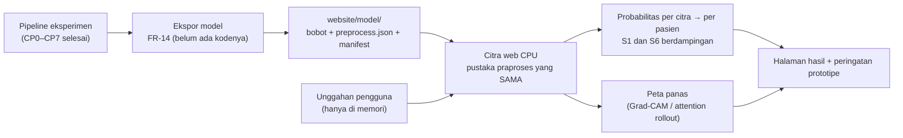

# Rencana Website Prototipe (CP8) – End to End

Dokumen perencanaan. **Belum ada kode website.** Berisi apa yang akan dibangun, bagaimana terhubung ke pipeline eksperimen,
keputusan yang masih terbuka, dan kriteria selesai. Rujukan: [PRD.md](../PRD.md) bagian 9 (WR-01 sampai WR-08), bagian 13
(Docker dan CP8), FR-14; aturan kerja di [RULES.md](../RULES.md).

> Website hanya **mendemonstrasikan** hasil dan tidak menambah bukti ilmiah. Ia hanya menjalankan klasifikator; GAN tidak
> berjalan di website. Ia adalah prototipe riset, bukan alat diagnosis.

---

## 1. Tujuan dan batas

**Tujuan (G5 di PRD):** pengguna mengunggah citra CE-NBI satu pasien dan memperoleh probabilitas ganas dari dua model dalam waktu
yang wajar (batas dibenchmark, bukan diasumsikan).

| Dalam lingkup | Di luar lingkup |
| --- | --- |
| Unggah banyak citra dari satu pasien | Menjalankan atau melatih GAN di website |
| Dua model berdampingan: tanpa GAN (S1) dan dengan GAN berpandu ROI (S6) | Evaluasi kuantitatif peta panas |
| Probabilitas per citra dan per pasien (rata-rata, ganas bila ≥ 0,5) | Penggunaan klinis, penyimpanan data pasien |
| Peta panas berlabel "area yang memengaruhi prediksi" | Akun pengguna, basis data riwayat |
| Contoh demo dari pasien uji (tanpa kebocoran) | Multi-pusat, multimodal |

## 2. Alur end to end



Urutan ketergantungan: **website tidak bisa dibangun penuh sebelum CP5 (S6) selesai**, karena model S6 dan konfigurasi
terbaiknya belum ada. Kerangka antarmuka dan alur unggah dapat dikerjakan lebih dulu dengan model S1 atau model tiruan.

## 3. Persyaratan dan cara memeriksanya

| ID | Persyaratan (dari PRD §9) | Cara diperiksa |
| --- | --- | --- |
| WR-01 | Unggah banyak citra satu pasien; tolak berkas bukan citra; tampilkan jumlah citra diproses | Uji: kirim 3 JPG + 1 PDF → 3 diproses, 1 ditolak dengan pesan jelas |
| WR-02 | Praproses sama dengan pelatihan, **satu pustaka bersama** | Uji kesetaraan: citra yang sama lewat `src.preprocess` dan lewat website → larik identik (toleransi 0) |
| WR-03 | Dua model berdampingan (tanpa GAN vs berpandu ROI) di layar yang sama | Uji UI: kedua probabilitas pasien tampil bersamaan |
| WR-04 | Tabel probabilitas per citra, dapat diurutkan; pasien = rata-rata; ganas bila ≥ 0,5 | Uji: nilai pasien = rata-rata kolom citra; ambang 0,5 inklusif |
| WR-05 | Peta panas berlabel "area yang memengaruhi prediksi", bukan lokalisasi lesi; tidak dievaluasi kuantitatif | Pemeriksaan teks label; tidak ada klaim akurasi lokalisasi |
| WR-06 | Setiap halaman hasil memuat peringatan prototipe | Uji: teks peringatan ada di semua respons hasil |
| WR-07 | Contoh demo tanpa kebocoran: dari pasien uji milik model yang ditampilkan | Uji otomatis: ID pasien contoh ∈ `test` lipatan model; ∉ `train`/`val` |
| WR-08 | Citra unggahan tidak disimpan setelah permintaan selesai dan tidak dicatat di log | Uji: setelah permintaan, tidak ada berkas baru di disk; log tidak memuat nama berkas atau isi citra |
| (G5) | Waktu respons wajar | Benchmark di mesin tujuan (CPU, tanpa GPU), dicatat di `benchmark_web.json` |

## 4. Rancangan teknis (usulan, bukan keputusan)

### 4.1 Struktur folder yang diusulkan

```
website/
├── RENCANA_WEBSITE.md          (berkas ini)
├── app/                        aplikasi Python: rute, antarmuka, inferensi, peta panas
├── model/                      hasil ekspor (di luar git): bobot + preprocess.json + manifest.json
├── examples/                   contoh demo dari pasien uji (di luar git; data medis)
├── tests/                      uji WR-01 sampai WR-08
├── Dockerfile.web              citra CPU ramping, terpisah dari citra pipeline
└── requirements.web.in/.lock   dependensi minimal (tanpa pyradiomics, ctgan, lpips, jupyter)
```

### 4.2 Satu aplikasi Python yang mengimpor pustaka pipeline (rekomendasi PRD)

Menghapus risiko selisih praproses pelatihan vs layanan (WR-02). Yang dipakai ulang dari `src/`:
- `src.preprocess.process_array` untuk area pandang, crop persegi, resize 256.
- `src.data.build_transform(cfg, train=False)` untuk resize 224 dan normalisasi ImageNet.
- Pemuatan Swin-T lewat `transformers` seperti `src.models.build_classifier`.

Catatan yang perlu diubah di pipeline: `process_array` juga menghitung peta ROI (Frangi), yang **tidak dibutuhkan** untuk inferensi
dan menambah waktu. Perlu parameter `compute_roi=False` untuk layanan (perubahan kecil, harus diuji agar keluaran citra tidak berubah).

### 4.3 Endpoint

| Endpoint | Fungsi |
| --- | --- |
| `GET /` | Halaman unggah + pilihan contoh demo |
| `POST /predict` | Terima banyak berkas → probabilitas per citra dan per pasien untuk kedua model (+ peta panas opsional) |
| `GET /examples` | Daftar contoh demo (sudah dipastikan dari pasien uji) |
| `GET /health` | Cek hidup + hash model yang dimuat (dari `manifest.json`) |

### 4.4 Peta panas

Pilih satu: Grad-CAM pada lapisan akhir Swin, atau attention rollout. Tentukan saat implementasi. Label tetap
"area yang memengaruhi prediksi". PRD tidak meminta evaluasi kuantitatif, tetapi sangat disarankan satu uji kewarasan
(peta berubah jelas bila bobot diacak) agar tidak menampilkan peta yang sebenarnya tidak bergantung pada model.

### 4.5 Privasi (WR-08) – ketentuan implementasi

- Unggahan diproses **hanya di memori**; tidak ada penulisan ke disk (termasuk berkas sementara dan cache peta panas).
- Matikan pencatatan isi permintaan dan nama berkas pada server; log hanya status dan waktu.
- Batasi ukuran berkas dan jumlah citra per permintaan; validasi tipe berdasarkan isi, bukan hanya ekstensi.
- Gunakan HTTPS bila diakses lewat jaringan. Tidak ada cookie pelacak, tidak ada analitik pihak ketiga.
- Tampilkan di halaman bahwa unggahan tidak disimpan, dan jangan mengunggah data yang bukan milik pengguna.

## 5. Ekspor model (FR-14) – pekerjaan baru di pipeline

Belum ada kodenya. Usulan modul `src/export_model.py`:

```bash
python -m src.export_model --scenario S1 --rep 0 --fold 0 --out website/model/s1
python -m src.export_model --scenario S6_r50 --rep 0 --fold 0 --out website/model/s6   # rasio sesuai best_config.json
```

Keluaran per model: `model.pt` (state_dict dari `best.pt`), `preprocess.json` (konfigurasi praproses + nama Swin-T + ukuran masukan +
mean/std + ambang 0,5), `manifest.json` (SHA-256 berkas, ID job asal, hash commit, hash citra Docker, hash split, daftar pasien `test`).

Daftar pasien `test` di manifest adalah dasar WR-07.

## 6. Keputusan yang harus kamu ambil (belum diputuskan)

| ID | Keputusan | Pilihan / rekomendasi saya |
| --- | --- | --- |
| W1 | **Model mana yang ditampilkan** (ada 10 model per skenario, satu per lipatan) | Satu pasang model dari **lipatan yang sama** untuk S1 dan S6. Pilih lipatan dengan aturan yang ditetapkan **sebelum** melihat hasil (mis. rep 0, lipatan 0), bukan yang paling bagus. Ensemble 10 lipatan menyulitkan WR-07 karena setiap pasien pernah dilatihkan di sebagian model. Model yang dilatih ulang pada 210 pasien juga membuat semua contoh demo bocor dan di luar PRD. |
| W2 | Kerangka kerja antarmuka | FastAPI + halaman HTML sederhana (kontrol penuh atas penyimpanan dan log, mudah memenuhi WR-08), atau Gradio/Streamlit (cepat dibuat, tetapi perlu dicek pencatatan dan berkas sementara bawaannya terhadap WR-08). Rekomendasi: FastAPI. |
| W3 | **Hosting (D5 di PRD)**: lokal/lab atau daring | Untuk demo sidang, lokal paling aman. Daring berarti pihak lain dapat mengunggah citra medis ke server kalian: perlu pertimbangan privasi dan tanggung jawab sebelum dibuka. Putuskan setelah benchmark waktu inferensi di CPU. |
| W4 | Pembagian tugas | PRD §12 menyarankan satu orang memegang pipeline dan satu orang evaluasi/website, tetapi keputusan ada pada kalian. Tulis di LOG.md. |
| W5 | Sumber contoh demo | Beberapa pasien dari `test` lipatan model W1, termasuk jinak dan ganas, dipilih dengan seed tetap. Citra adalah data medis: simpan di luar git dan jangan dipublikasikan tanpa menimbang lisensi CC BY 4.0 dan etika. |

## 7. Tahapan kerja (tanpa perkiraan waktu; ukur dulu)

| # | Pekerjaan | Syarat mulai | Selesai bila |
| --- | --- | --- | --- |
| 1 | Putuskan W1 sampai W5; tulis di `configs/decisions.yaml` dan LOG.md | – | keputusan tercatat |
| 2 | `compute_roi=False` pada `process_array` + uji bahwa keluaran citra tidak berubah | – | uji lulus |
| 3 | Kerangka aplikasi (unggah, validasi, tabel, peringatan) dengan model tiruan | 1 | WR-01, WR-04, WR-06 lulus |
| 4 | `src/export_model.py` + manifest | CP3 (untuk S1) | model S1 terekspor, hash cocok |
| 5 | Inferensi dua model + peta panas | 3, 4, dan **CP5** untuk S6 | WR-02, WR-03, WR-05 lulus |
| 6 | Contoh demo tanpa kebocoran | 4 | WR-07 lulus (uji otomatis) |
| 7 | Uji privasi | 3 | WR-08 lulus |
| 8 | Citra Docker web (CPU, ramping) + benchmark latensi | 5 | `benchmark_web.json` tercatat; citra jalan di mesin bersih |
| 9 | Gerbang CP8: WR-01 sampai WR-08 terpenuhi | 1–8 | `cp8_check.json` lulus; tag `cp8` setelah ditinjau orang kedua |

## 8. Risiko

| Risiko | Dampak | Penanganan |
| --- | --- | --- |
| Selisih praproses pelatihan vs layanan | prediksi web tidak sama dengan hasil pipeline | satu pustaka bersama + uji kesetaraan WR-02 |
| Kebocoran pada contoh demo | demo tampak bagus karena model pernah melihat pasiennya | uji otomatis WR-07 dari manifest |
| Peta panas disalahartikan sebagai lokalisasi lesi | klaim berlebihan | label tetap, tanpa klaim akurasi, peringatan prototipe |
| Latensi CPU terlalu tinggi untuk banyak citra | pengalaman buruk / timeout | benchmark di mesin tujuan; batasi jumlah citra per permintaan; proses berurutan |
| Unggahan tersimpan tanpa sengaja (berkas sementara, log, cache) | pelanggaran WR-08 | uji privasi otomatis; tidak memakai kerangka yang menulis ke disk tanpa kontrol |
| Memilih model demo yang kebetulan paling bagus | tampilan menyesatkan | aturan pemilihan lipatan ditetapkan sebelumnya (W1) |
| Dependensi citra web membengkak | citra besar dan lambat dibangun | dependensi minimal, terpisah dari citra pipeline |

## 9. Catatan kejujuran

- Angka kinerja yang tampil di website (bila ada) harus berasal dari `results_*.csv` pipeline dengan interval kepercayaan; jangan
  menampilkan satu angka tanpa interval (PRD §10).
- Hasil satu pasien di website bukan evaluasi. Evaluasi ada di tabel pipeline per 210 pasien.
- Rencana ini belum diuji dalam bentuk apa pun; semua estimasi waktu dan kinerja harus diukur.
